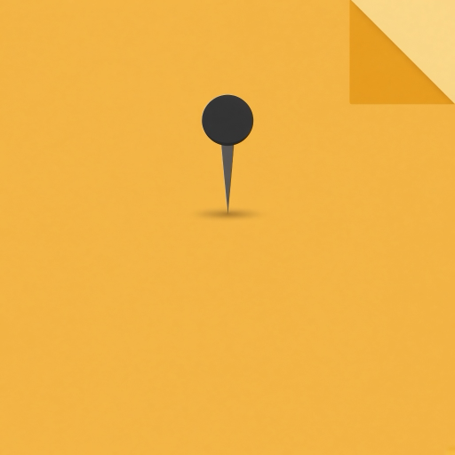

<p align="center">
  
</p>

<p align="center">
  Colored sticky notes for the Mac, with a small pin in the menu bar.
</p>

<p align="center">
  <a href="LICENSE">MIT</a>
  ·
  macOS 13+
  ·
  <a href="CONTRIBUTING.md">Contributing</a>
  ·
  <a href="SECURITY.md">Security</a>
  ·
  <a href="PRIVACY.md">Privacy</a>
</p>

# pinFiy

Colored sticky notes for the Mac. Each note is its own window. Arabic text runs right to left and English text runs left to right, based on the first strong character. Pin keeps a note above normal windows and does not cover the menu bar. The app itself stays as a pin in the menu bar and does not appear in the Dock.

The repository image is a 512×512 PNG at [`docs/pinFiy-512.png`](docs/pinFiy-512.png). Upload that file as the GitHub repository image.

## Features

- Ten light colors and ten dark colors. The default is warm amber `#F3C15B`. Dark text sits on light colors, and light text sits on dark colors.
- Font size from 12 to 36, per note, and from Settings for new notes or for every note.
- Locking a note blocks text, color, size, position, and closing.
- Local storage at `~/Library/Application Support/pinFiy/notes.json`, with a backup.
- Keyboard shortcuts, and confirmation before deleting a note that has text.
- Open at login from Settings or from the pin menu.
- No account, no cloud sync, and no network access.

## Requirements

- macOS 13 or later
- Swift 5.9 or later, including the toolchain shipped with Xcode

## Build and test

```bash
git clone https://github.com/Alhamou/pinFiy.git
cd pinFiy
swift test
./scripts/build-app.sh
open PinFiy.app
```

`./scripts/build-app.sh` builds `PinFiy.app` with bundle id `app.pinfiy.PinFiy`, installs the icon, and ad-hoc signs the bundle. That is not an Apple Developer signature and not an App Store release.

## Usage

| Action | How |
| --- | --- |
| New note | `+`, ⌘N, or the pin menu |
| Close | `×` or ⌘W. Non-empty text asks for confirmation |
| Keep above windows | Pin button or ⌘P |
| Lock editing | Lock button on the note |
| Color and font size | Color swatches and `A−` / `A+` |
| Settings | ⌘, or the pin menu |
| Quit | ⌘Q or the pin menu |

The pin corner follows the text direction: right for Arabic, left for English.

## Project layout

```text
Package.swift          Swift package
Sources/PinFiyCore     Model and storage, no AppKit
Sources/PinFiyApp      Note windows and the menu bar
Tests/PinFiyCoreTests  XCTest tests
scripts/build-app.sh   Builds PinFiy.app
docs/pinFiy-512.png    512×512 logo
```

## Contributing

Read [CONTRIBUTING.md](CONTRIBUTING.md) and [CODE_OF_CONDUCT.md](CODE_OF_CONDUCT.md). Report a security issue privately as described in [SECURITY.md](SECURITY.md).

## License

[MIT](LICENSE) © 2026 pinFiy contributors
